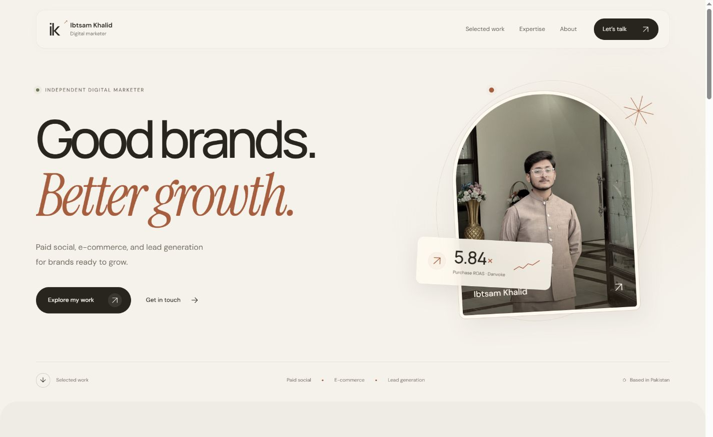

<div align="center">

# Ibtsam Khalid · Portfolio

**Good brands. Better growth.**

A personal portfolio for an independent digital marketer in Pakistan.<br>
Paid social, e-commerce, and lead generation — presented with a warm, editorial design.

[Features](#features) · [Run locally](#quick-start) · [Customize](#customization) · [Deploy](docs/DEPLOYMENT.md)

**HTML5 · CSS3 · Vanilla JavaScript · No runtime packages · No compilation step**

</div>



<details>
<summary>View the mobile preview</summary>
<br>


</details>

## Overview

A single-page portfolio that introduces Ibtsam, presents selected campaign work, and helps prospective clients start a conversation. The interface combines ivory backgrounds, espresso typography, copper accents, original photography, and a floating navigation bar.

The website runs directly in a browser. There is no framework, package installation, application server, or API key to configure. Optional Python tooling validates the repository and assembles a deployment folder.

## Features

| Feature | What it does |
| --- | --- |
| Responsive layout | Adapts the navigation, project cards, portrait, and inquiry form to smaller screens. |
| Project galleries | Opens campaign screenshots in a native dialog with captions, previous/next controls, arrow-key navigation, and Escape to close. |
| Contact drafts | Prepares an email or WhatsApp message for the visitor to review and send. |
| Service shortcuts | Preselects a service in the inquiry form from the expertise section. |
| Motion preferences | Respects system reduced-motion settings and remembers the visitor's footer preference locally. |
| Keyboard support | Includes a skip link, visible focus styles, labeled controls, and focus restoration after closing a gallery. |
| Progressive enhancement | Keeps portfolio copy visible without JavaScript; direct email and WhatsApp links remain available. |
| Lightweight delivery | Uses deferred scripts, lazy-loaded project images, and no JavaScript runtime dependencies. |

### Selected work

| Project | Focus | Reported results |
| --- | --- | --- |
| **Danvoke** | Paid social and e-commerce | 5.84× purchase ROAS; Rs. 283,500 revenue |
| **Hafiz Elevators** | Meta Ads and B2B lead generation | 142 form leads; 118,654 people reached |

Figures come from the supplied campaign materials for **August 24–30, 2025**. They describe those campaigns and are not forecasts or guarantees.

## Quick start

Download or clone this repository, open a terminal in its root directory, and run:

```sh
python -m http.server 4173 --bind 127.0.0.1
```

Visit [localhost:4173](http://127.0.0.1:4173). Stop the server with `Ctrl+C`.

On macOS or Linux, use `python3` if `python` is unavailable. On Windows, `py` also works. You can open `index.html` directly for a quick look, although a local server more closely matches deployment behavior.

### Development commands

Use **Python 3.12+** and **Node.js 24** for the repository checks. Neither is needed by visitors, and there are no packages to install for these commands.

| Command | Purpose |
| --- | --- |
| `python scripts/site.py check` | Validate assets, page references, documentation links, and JavaScript syntax. |
| `python -m unittest discover -s tests -v` | Run regression tests for the validation and packaging tools. |
| `python scripts/site.py build` | Validate and copy the published files into `dist/`. |
| `python -m http.server 4173 --bind 127.0.0.1 --directory dist` | Preview the deployment output after building. |

## Project structure

```text
.
├── index.html                  # Content, metadata, navigation, and inquiry form
├── styles.css                  # Theme, responsive layout, and motion rules
├── app.js                      # Galleries, navigation, contact drafts, preferences
├── transitions.js              # Section transitions and interaction effects
├── favicon.svg                 # Portfolio monogram
├── My image/                   # Portrait photography
├── Projects I worked on/       # Campaign screenshots and source imagery
├── site-files.json             # Explicit list of files included in deployment
├── scripts/site.py             # Validation and static packaging
├── tests/                      # Tooling regression tests
├── docs/                       # Deployment, testing, and README screenshots
├── .github/                    # CI, Pages workflow, issue and PR templates
├── CONTRIBUTING.md             # Contribution workflow and conventions
└── extract_assets.py           # Optional PDF-to-image utility
```

Local backups, temporary previews, virtual environments, and `dist/` are ignored by Git. The README's two curated screenshots live in `docs/images/` and are versioned separately.

## Customization

| Change | Where to edit |
| --- | --- |
| Name, introduction, services, and project copy | `index.html` |
| Page title, description, and Open Graph text | The `<head>` in `index.html` |
| Email address and WhatsApp number | Both the visible links in `index.html` and the constants near the top of `app.js` |
| Gallery images, alternative text, and captions | The `evidence` object in `app.js` |
| Colors, fonts, and easing | The `:root` custom properties in `styles.css` |
| Responsive behavior and reduced-motion styles | The media queries in `styles.css` |
| Section transitions and pointer effects | `transitions.js` |
| Files that reach the public website | `site-files.json` |

Keep image filenames and letter case consistent. The existing image directories contain spaces; HTML uses URL-encoded paths such as `My%20image/ibtsam-portrait.jpg`. Add new public assets to `site-files.json` and run the checks before deploying.

When replacing campaign figures, also update their captions and reporting dates. When replacing images, update their alternative text and dimensions.

## Deployment

The included **Deploy GitHub Pages** workflow validates and packages the site, then publishes only `dist/`. It runs manually from the default branch after GitHub Pages is enabled; a normal push only runs the checks.

See the [deployment guide](docs/DEPLOYMENT.md) for the first GitHub push, Pages setup, custom-domain considerations, and deployment to another static host. The workflow follows GitHub's [custom Pages workflow guidance](https://docs.github.com/en/pages/getting-started-with-github-pages/using-custom-workflows-with-github-pages).

No live deployment URL is configured in this repository yet. Once published, add the confirmed URL to this README and the repository's **About → Website** field.

## Contact and data behavior

- The inquiry form creates a draft in the browser. It does not send messages or store inquiries on a server.
- Opening an email or WhatsApp draft passes the prepared message to that application. The visitor sends it there; email requires a configured email handler.
- The only browser preference written by the site is `ibtsam-reduced-motion` in `localStorage`.
- Google Fonts supplies Manrope, DM Sans, and Instrument Serif. The browser contacts Google's font services when online; system fonts provide fallbacks.
- There are no analytics scripts, authentication flows, or backend integrations in the current source.

## Quality checks

[CI](.github/workflows/ci.yml) runs the checks, tooling tests, and packaging on Linux and Windows for pushes and pull requests. It checks missing and incorrectly cased assets, local page links, duplicate IDs, referenced accessibility labels, image alternative-text attributes, gallery assets, documentation file links, and JavaScript syntax.

These are static and tooling checks, not browser interaction tests or an accessibility audit. Use the [manual testing guide](docs/TESTING.md) for responsive layout, keyboard navigation, motion controls, and contact drafts. The README previews are saved captures, not generated by CI.

## Optional: extract images from a PDF

The images needed to run the site are already included. To extract assets from another source PDF, install [PyMuPDF](https://pymupdf.readthedocs.io/en/latest/tutorial.html) in a virtual environment and run:

```sh
python -m venv .venv
# Activate .venv using the command for your shell.
python -m pip install PyMuPDF
python extract_assets.py "path/to/portfolio.pdf" --output assets
```

On Windows PowerShell, activation is `.venv\Scripts\Activate.ps1`; on macOS/Linux it is `source .venv/bin/activate`. The helper renders each PDF page and extracts its embedded images. It requires a new or empty output directory to avoid replacing existing work. The original source PDF is not included, and extraction is not part of CI or deployment.

## Contributing and reuse

Bug reports and focused improvements are welcome. Read [CONTRIBUTING.md](CONTRIBUTING.md) for the workflow and use the included issue and pull request templates.

**No open-source license has been selected.** This repository includes personal photography, client branding, and campaign materials; it does not grant an additional reuse license for those assets or the source code. Contact the owner to discuss reuse.

---

<div align="center">

**Ibtsam Khalid** · Independent digital marketer<br>
[Email](mailto:ibtsam.official591@gmail.com) · [WhatsApp](https://wa.me/923712298591)

</div>
